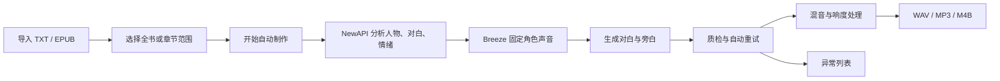

# 声章 · 小说讲书工作台

面向普通创作者的 Windows 本地小说自动配音工具。导入 TXT/EPUB 后，只需选择章节范围并点击一次 **开始自动制作**，应用会完成文本分析、人物识别、固定声音设计、情绪对白生成、质检、混音和章节导出。

> 当前版本使用 NewAPI 做文本分析，使用本机 Breeze TTS 2 做声音设计和语音生成；不会重复安装 IndexTTS，也不会在生成中悄悄切换音色或引擎。

## 你能得到什么

- **一次启动全流程**：导入小说 → 选择范围 → 开始自动制作。
- **角色声音保持一致**：每个角色固定声音档案、录音、seed、模型版本和生成参数；情绪只改变表达，不换声线。
- **自动识别对白**：识别旁白、说话人和喜怒哀乐；低置信说话人自动按旁白处理，不阻塞整本书。
- **自动续做**：每章完成立即留档。重启后跳过文本、声音、片段和导出签名都未变化的章节。
- **失败集中处理**：每章或片段自动重试一次，仍失败才进入异常列表，其他章节继续制作。
- **完整音频输出**：对白清晰优先的背景压低、停顿、响度处理，按章输出 WAV/MP3，全部完成后生成 M4B。
- **普通界面少操作**：人物档案、声纹分数、片段表格和模型参数收进高级设置，只有无法自动解决的问题才需要人工处理。

## 工作流程



## 快速开始（Windows）

### 1. 获取代码

```powershell
git clone https://github.com/<你的账号>/novel-voice-studio.git
cd novel-voice-studio
```

### 2. 准备本机依赖

建议使用 Python 3.10 或更高版本。创建环境并安装基础依赖：

```powershell
py -3.11 -m venv .venv
.venv\Scripts\python.exe -m pip install -r requirements.txt
```

Breeze TTS 2 的源码、推理依赖和模型权重请按上游项目说明准备，并在应用的 **声音与模型 → Breeze TTS** 中填写路径。模型权重体积较大，仓库不会上传它们。

### 3. 启动

双击 `启动小说讲书工作台.bat`，或运行：

```powershell
.venv\Scripts\python.exe -u main.py
```

### 4. 配置文本分析

进入 **声音与模型 → 文本分析 · NewAPI**，填写接口地址、模型名称和密钥，点击 **保存接口设置**，再点击 **测试连接**。密钥使用 Windows 当前账号加密保存，重启后会自动读取。

### 5. 自动制作

1. 点击 **导入小说**，选择 TXT 或 EPUB。
2. 选择 **全书**、**当前章节**或自定义章节范围。
3. 点击 **开始自动制作**，等待中央进度窗口完成。
4. 完成后在首页播放章节、打开输出目录或导出 M4B。

普通用户不需要试听声卡、填写录音文字稿、手动绑定人物、逐条生成或逐段确认。需要处理的内容只会出现在异常列表中。

## 断点续做与重做

- 点击 **继续制作**：只处理未完成或签名已变化的章节。
- 点击 **重新制作异常章节**：批量重试自动重试仍失败的章节。
- 点击 **批量重新生成**：选择章节后重新生成，不影响其他章节的固定声音。
- 点击 **重新导出已完成章节**：只重新执行混音和导出。
- 点击 **打开输出目录**：直接查看生成文件。
- 关闭窗口或点击停止后，已完成的声音、片段和章节都会保留。

## 目录说明

| 目录 | 用途 |
| --- | --- |
| `novel_studio/` | 应用源码 |
| `tests/` | 自动化测试 |
| `scripts/` | 启动与辅助脚本 |
| `使用说明.md` | 面向普通用户的中文操作说明 |
| `models/` | 本机模型目录，不提交到 Git |
| `runtimes/` | 本机 Breeze/推理运行环境，不提交到 Git |

项目数据默认保存在 Windows 的 `文档\小说讲书`，包含文本分析结果、角色声音档案、音频、任务日志和导出文件。API 密钥保存在 `%APPDATA%\NovelVoiceStudio`，不会写入项目 JSON。

## 开发与验证

```powershell
.venv\Scripts\python.exe -m unittest discover -s tests -v
.venv\Scripts\python.exe -m compileall -q main.py novel_studio tests
```

提交代码前请确认没有把 `.venv`、模型权重、运行环境、小说原文、API 密钥或生成音频加入 Git。仓库根目录的 `.gitignore` 已默认排除这些内容。

## 许可与责任

应用代码采用 MIT License。Breeze TTS 2、模型权重、IndexTTS、FFmpeg、音效和用户导入的小说内容分别遵循各自许可；使用前请阅读 [THIRD_PARTY_NOTICES.md](THIRD_PARTY_NOTICES.md)。当前默认配置按研究和非商业用途编写。

欢迎提交 Issue 反馈导入、识别、固定音色、断点续做和导出问题。
